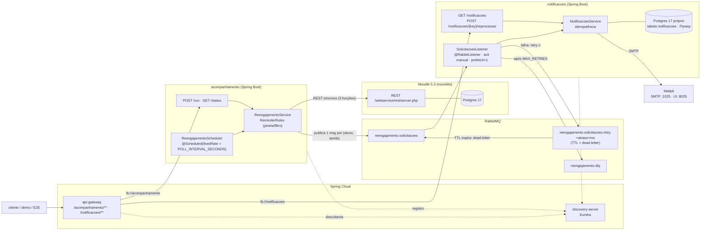
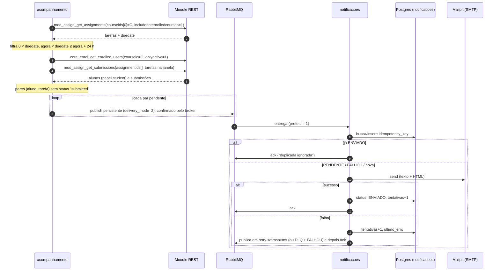

# Arquitetura

Serviço de reengajamento: envia um lembrete por e-mail a cada aluno que ainda não enviou uma tarefa do Moodle que vence nas próximas 24 h.

## Visão geral



| Componente | Imagem / stack | Porta (host) |
|---|---|---|
| `moodle` | `erseco/alpine-moodle:v5.3.1` | 8080 |
| `moodle-db` | `postgres:17-alpine` (Moodle 5.3 exige Postgres ≥ 17) | — |
| `rabbitmq` | `rabbitmq:3-management` | 5672, 15672 (painel) |
| `mailpit` | `axllent/mailpit:v1.34` | 1025 (SMTP), 8025 (UI/API) |
| `discovery-server` | Spring Boot 4.2 + Eureka Server | 8761 |
| `api-gateway` | Spring Boot 4.2 + Spring Cloud Gateway (WebFlux) | 9000 |
| `acompanhamento` | Spring Boot 4.2 / Java 21 | 8081 (`/docs`) |
| `notificacoes` | Spring Boot 4.2 / Java 21 | 8082 (`/docs`) |
| `notificacoes-db` | `postgres:17-alpine` | — |

Volumes nomeados: `moodle_db`, `moodle_html`, `moodle_data`, `rabbitmq_data`, `mailpit_data`, `notificacoes_db`. Sobrevivem a `docker compose down` / `up`; só `make clean` (`down -v`) os apaga.

Cada microsserviço tem o próprio banco (*database per service*): o `notificacoes` usa o `notificacoes-db`; o `acompanhamento` não guarda estado (o Moodle é a fonte da verdade).

## Fluxo de um ciclo



## Pacotes

**acompanhamento** (`br.pucrs.es2.acompanhamento`)

| Pacote | Responsabilidade |
|---|---|
| `config` | `AcompanhamentoProperties` (`@ConfigurationProperties` validado com Bean Validation), `MoodleHttpConfig` (`RestClient` com timeouts, sem redirecionamento e com o `Host` público), `RabbitConfig` (fila durável + conversor JSON), `ClockConfig` |
| `moodle` | `MoodleClient` (POST form-urlencoded; normaliza erros: timeout, rede, HTTP, `exception`, HTML), `MoodleParams` (arrays no formato `courseids[0]`), `MoodleService` (as 3 funções e os filtros), `dto/` |
| `messaging` | `SolicitacaoPublisher`: publicação persistente com `message_id` e espera do *publisher confirm* |
| `reengajamento` | `ReminderRules` (regras puras), `ReengajamentoService` (ciclo + status, um ciclo por vez), `ReengajamentoScheduler` (`@Scheduled`), `ReengajamentoController` (`/run`, `/status`), `dto/` |

**notificacoes** (`br.pucrs.es2.notificacoes`)

| Pacote | Responsabilidade |
|---|---|
| `config` | `NotificacoesProperties`, `RabbitConfig` (topologia principal/retry/DLQ como `Declarables`), `ClockConfig` |
| `messaging` | `SolicitacoesListener` (destino de cada mensagem, ack/nack manual), `RetryPolicy` (backoff exponencial), `RabbitPublisher` (publicação confirmada), `Filas` |
| `mail` | `MailService` (`JavaMailSender`, multipart texto + HTML, cabeçalho `X-Idempotency-Key`) e `LembreteTemplate` (pt-BR, `America/Sao_Paulo`, HTML escapado) |
| `notificacao` | Entidade JPA `Notificacao`, `NotificacaoRepository`, `NotificacoesService` (idempotência, tentativas, reprocessamento), `NotificacoesController`, `dto/` |
| `resources/db/migration` | `V1__create_notificacoes.sql` (Flyway; o Hibernate só valida, `ddl-auto=validate`) |

**discovery-server**: `@EnableEurekaServer`, sem se registrar em si mesmo; *self-preservation* desligado e evicção a cada 10 s (ambiente de demo).

**api-gateway**: rotas `Path=/acompanhamento/**` → `lb://acompanhamento` e `Path=/notificacoes/**` → `lb://notificacoes`, ambas com `StripPrefix=1`. O `lb://` resolve as instâncias no Eureka (Spring Cloud LoadBalancer, cache de 5 s).

Health: os dois serviços expõem `/health` (Actuator) com RabbitMQ, banco (notificacoes) e Eureka. O mesmo caminho é usado no `HEALTHCHECK` do Docker e no `health-check-url-path` do Eureka.

## Mensagem `reengajamento.solicitacoes`

JSON, `content_type=application/json`, `delivery_mode=2`, `message_id = idempotency_key`.

```json
{
  "idempotency_key": "2:1:4",
  "course_id": 2,
  "course_name": "Engenharia de Software II",
  "assign_id": 1,
  "cmid": 2,
  "assign_name": "T1 - Diagrama de casos de uso",
  "duedate": "2026-11-21T08:49:33Z",
  "duedate_epoch": 1795250973,
  "user_id": 4,
  "user_fullname": "Ana Souza",
  "user_email": "aluno1@example.com",
  "assign_url": "http://localhost:8080/mod/assign/view.php?id=2",
  "created_at": "2026-11-20T20:50:05.453513965Z"
}
```

- `idempotency_key` = `{course_id}:{assign_id}:{user_id}`: um lembrete por aluno e tarefa.
- Datas em UTC (ISO 8601) + epoch; o e-mail exibe em `America/Sao_Paulo`.
- Os dois serviços usam o mesmo contrato (`record SolicitacaoLembrete`, JSON em `snake_case`). O consumidor valida a mensagem com Bean Validation; uma mensagem inválida (JSON malformado, campo ausente, e-mail inválido) vai direto para a DLQ.

Cabeçalhos usados no retry: `x-retry-count` (novas tentativas já feitas) e `x-last-error`.

## Filas

| Fila | Argumentos | Papel |
|---|---|---|
| `reengajamento.solicitacoes` | durável | Principal. Declarada igual pelos dois serviços. |
| `reengajamento.solicitacoes.retry.<atraso>ms` | durável, `x-message-ttl=<atraso>`, `x-dead-letter-exchange=""`, `x-dead-letter-routing-key=reengajamento.solicitacoes` | Espera da n-ésima nova tentativa. Ao expirar, a mensagem volta para a principal. |
| `reengajamento.dlq` | durável | Mensagens que esgotaram `MAX_RETRIES` (registro `FALHOU`) ou inválidas. |

Atrasos: `RETRY_BASE_DELAY_MS × 2^n` (padrão 5 s, 10 s, 20 s, 40 s, 80 s). Após `MAX_RETRIES` (padrão 5) novas tentativas, a mensagem vai para a DLQ: 1 envio original + 5 novas tentativas.

## Decisões

| Decisão | Motivo |
|---|---|
| **Spring Boot 4.2 + Spring Cloud 2026.0** | A disciplina usou microsserviços Spring. Boot 4.2 é a versão atual, e o *release train* 2026.0 é o compatível com ela. Java 21 (LTS). |
| **Eureka + API Gateway, sem Config Server** | Eureka e Gateway trazem descoberta e um ponto de entrada único, que aparecem na demo e no E2E. Com só dois serviços e configuração já centralizada no `.env` do compose, um Config Server não acrescentaria nada. |
| **Lease do Eureka de 5 s e cache do LoadBalancer de 5 s** | Os padrões (30 s / 35 s) fariam o gateway responder 503 por quase um minuto depois de subir ou recriar um serviço. Em demo isso atrapalha; em produção os padrões fariam sentido. |
| **Postgres próprio para o notificacoes** | Um banco por serviço. Flyway cria o esquema (`V1`); o Hibernate só valida o mapeamento. |
| **Imagem `erseco/alpine-moodle`** | O catálogo gratuito da Bitnami foi descontinuado; `bitnamilegacy/moodle` não recebe mais atualizações. A erseco é mantida, multi-arquitetura (amd64/arm64), instala o Moodle sozinha via variáveis de ambiente e aceita volumes para código e `moodledata`. Fixada em `v5.3.1` para ser reproduzível. |
| **Postgres 17** | O instalador do Moodle 5.3 recusa Postgres 16 ("version 17 is required"). |
| **Cabeçalho `Host` nas chamadas REST** | O Moodle redireciona (303) requisições cujo host difere do `wwwroot` (`http://localhost:8080`). Dentro do compose o acompanhamento chama `http://moodle:8080`, então envia `Host: localhost:8080`. O `HttpClient` do JDK só permite isso com `jdk.httpclient.allowRestrictedHeaders=host`, definido no `main`. `$CFG->reverseproxy` resolveria, mas bloqueia o acesso direto pelo navegador (`reverseproxyabused`). |
| **Sem seguir redirecionamentos** | Um 303 do Moodle é erro de configuração (Host), não algo a seguir; vira `invalidresponse` no `/status`. |
| **Usuário de serviço com papel de sistema** | Não precisa ser matriculado: `moodle/course:view` + `includenotenrolledcourses=1`. Capabilities conferidas no código do Moodle 5.3: `webservice/rest:use`, `moodle/course:view`, `mod/assign:view`, `mod/assign:viewgrades`, `moodle/course:viewparticipants`, `moodle/course:enrolreview` (opção `onlyactive`), `moodle/user:viewdetails`, `moodle/site:viewuseridentity` (e-mail). |
| **Filtro de estudante pelo papel `student`** | `core_enrol_get_enrolled_users` com `userfields=id,fullname,email,roles` e `onlyactive=1`; só entram usuários com papel `student` e e-mail visível. |
| **Uma fila de retry por atraso (TTL na fila)** | TTL por mensagem numa fila só causa bloqueio de cabeça de fila (uma mensagem de 80 s segura as de 5 s). O nome da fila inclui o atraso, então mudar `RETRY_BASE_DELAY_MS` cria filas novas em vez de dar `PRECONDITION_FAILED`. |
| **Ack só depois de republicar** | A mensagem original só recebe ack quando a fila de retry/DLQ confirmou a publicação (`publisher-confirm-type: simple` + `waitForConfirmsOrDie`). Se o encaminhamento falhar, `basicNack(requeue=true)`, e a mensagem não se perde. |
| **Spring AMQP com ack manual em vez de retry do container** | O `RetryInterceptor` do Spring AMQP repete em memória, segurando a mensagem e o consumidor. As filas com TTL deixam o backoff visível no painel, sobrevivem a reinício e liberam o consumidor. A conexão do Spring AMQP reconecta sozinha e redeclara a topologia (`Declarables`). |
| **Idempotência no consumidor (`UNIQUE`)** | O produtor publica a cada ciclo enquanto o aluno não entrega, e isso é intencional: o consumidor garante 1 e-mail por chave. `FALHOU` não é terminal: uma nova solicitação reabre o registro. |
| **`POST /reprocessar` sempre republica** | Republica o payload original na fila principal. Se a chave já está `ENVIADO`, o consumidor ignora. Isso demonstra a idempotência pelo caminho real. |
| **Moodle não envia e-mails** (`noemailever=1`) | Evita e-mails do próprio Moodle (ex.: recibo de submissão) no Mailpit, o que atrapalharia a contagem dos testes. |
| **Mailpit com `MP_DATABASE` em volume** | Os e-mails sobrevivem ao `stop`/`start` do teste de falha. |
| **Health do SMTP desligado** | `management.health.mail.enabled=false`: Mailpit fora do ar é tratado com retry, e o serviço não deve ficar `unhealthy` (nem sair do Eureka) por isso. |
| **Sem ciclo automático na inicialização** | O primeiro ciclo agendado ocorre após `POLL_INTERVAL_SECONDS` (`initialDelay`), e `POST /run` dispara na hora. Isso mantém demo e testes determinísticos. |
| **Logs JSON (`logging.structured.format.console=logstash`)** | Uma linha JSON por evento. Os campos de contexto (`idempotency_key`, `assign_id`, `retry`, `err`...) vão como pares chave-valor do SLF4J (`addKeyValue`). |
| **Jackson 3 com `SNAKE_CASE` global** | Mensagens e APIs usam o mesmo formato do contrato (`idempotency_key`, `user_email`) sem anotar cada campo. |
